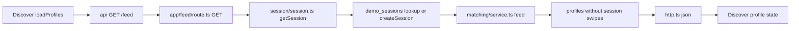
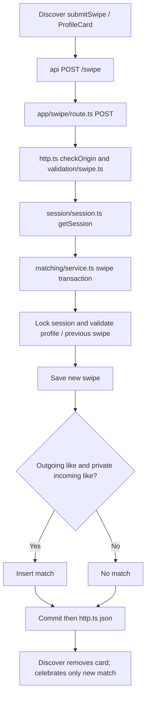
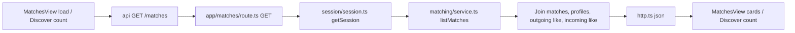

# API architecture

[Overview](../README.md) · [Database](DATABASE.md) · [Matching logic](MATCHING_LOGIC.md) · [Walkthrough](../PROJECT_WALKTHROUGH.md)

React calls same-origin JSON endpoints through [src/lib/api.ts](../src/lib/api.ts). Next.js App Router route handlers validate the request, resolve a browser session, call the matching service, and format JSON. All four handlers use the Node.js runtime. SQL stays in [src/lib/matching/service.ts](../src/lib/matching/service.ts); [src/lib/db/client.ts](../src/lib/db/client.ts) supplies a shared `pg` pool with at most five connections per process and an eight-second connection timeout.

## Shared request rules

[getSession()](../src/lib/session/session.ts) reads `coy_session` using Next.js's asynchronous `cookies()` API. A UUID is trusted only if its session row exists. Otherwise `createSession()` inserts a session and its private incoming-like fixtures atomically, then sets a new cookie: HTTP-only, SameSite=Lax, path `/`, one-year max age, and Secure in production. This is an anonymous demo identity, not production authentication. The caller cannot set a target session in JSON.

[src/lib/http.ts](../src/lib/http.ts) provides:

- `json()`: JSON plus `Cache-Control: private, no-store` on both successful and error responses.
- `checkOrigin()`: POST handlers reject a differing Origin or `Sec-Fetch-Site: cross-site` with 403. Requests without those headers are accepted; this is not token authentication.
- `handleError()`: intentional `ApiError` messages/statuses are returned; unexpected failures are logged on the server and produce a generic 503, without SQL, credentials, or private rows.

`GET` requests have no body or query parameters. Unused query parameters are ignored. Same-origin browser fetches carry the cookie automatically. Browser responses contain public profile fields only; no endpoint lists incoming likes.

## `GET /feed`

**Purpose:** return all profiles this session has not yet liked or passed, in stable fixture order.

**Source:** [src/app/feed/route.ts](../src/app/feed/route.ts). Caller: `loadProfiles()` in [Discover](../src/components/discover/discover.tsx), through `api()`.

**Request and validation:** no body; optional `coy_session` cookie, validated/created by `getSession()`.

**Service and database:** `feed(sessionId)` selects `publicProfile` from `profiles`, excluding rows with a matching `swipes` record for this session using `NOT EXISTS`. It does not read incoming likes. Session resolution reads `demo_sessions`; a new session additionally writes `demo_sessions` and `incoming_likes`.



**Response, 200:**

```json
{
  "profiles": [{
    "id": "00000000-0000-4000-8000-000000000001",
    "name": "Aarohi",
    "age": 23,
    "city": "Delhi",
    "bio": "Usually behind the camera. Looking for someone to get lost in bookstores and find the best momos with.",
    "interests": ["Photography", "Bookstores", "Coffee"],
    "photoUrl": "/demo-profiles/aarohi.svg"
  }]
}
```

A fresh session has 36 profiles. An exhausted feed returns `{ "profiles": [] }`. **Errors:** 503 if session lookup/creation or the query fails.

Discover waits for this response before requesting `/matches` for its count. That sequencing allows the first response to establish the cookie, avoiding two independent new sessions on initial load.

## `POST /swipe`

**Purpose:** save one outgoing decision and create a match only for a new mutual like.

**Source:** [src/app/swipe/route.ts](../src/app/swipe/route.ts). Caller: `submitSwipe()` in [Discover](../src/components/discover/discover.tsx), invoked by buttons, keyboard controls, or [ProfileCard](../src/components/discover/profile-card.tsx) drag completion.

**Request:** JSON with `Content-Type: application/json`; cookie resolves the session.

```json
{
  "profileId": "00000000-0000-4000-8000-000000000001",
  "direction": "like"
}
```

**Validation:** Origin/Fetch Metadata checks run first. Malformed JSON is rejected. [swipeInput](../src/lib/validation/swipe.ts) requires a UUID and `like` or `pass`; its strict object schema rejects extra fields, including `sessionId`. Only then is the session resolved.

**Service and database:** `swipe(sessionId, profileId, direction)` opens a transaction, locks the `demo_sessions` row, verifies the target in `profiles`, checks `swipes`, and inserts the new decision. Only a like looks up `incoming_likes` for that session/profile. A reciprocal like inserts `matches` in the same transaction. See [the algorithm and retry rules](MATCHING_LOGIC.md).



**Responses, 200:** a new non-match or identical retry returns:

```json
{ "success": true, "isMatch": false }
```

A new mutual like returns:

```json
{
  "success": true,
  "isMatch": true,
  "profile": {
    "id": "00000000-0000-4000-8000-000000000001",
    "name": "Aarohi",
    "age": 23,
    "city": "Delhi",
    "bio": "Usually behind the camera. Looking for someone to get lost in bookstores and find the best momos with.",
    "interests": ["Photography", "Bookstores", "Coffee"],
    "photoUrl": "/demo-profiles/aarohi.svg"
  }
}
```

**Errors:** 400 malformed JSON or invalid/extra fields; 403 cross-site request; 404 unknown profile; 409 a conflicting previous action; 503 unexpected database/setup failure. An identical retry does not overwrite a decision or emit a second celebration, even if the previous request created a match.

## `GET /matches`

**Purpose:** list confirmed mutual matches for this session, newest first.

**Source:** [src/app/matches/route.ts](../src/app/matches/route.ts). Callers: [MatchesView](../src/components/matches/matches-view.tsx) and Discover's match-count load.

**Request and validation:** no body; session cookie is validated/created as above.

**Service and database:** `listMatches(sessionId)` joins `matches`, `profiles`, `swipes` with action `like`, and `incoming_likes` for the same session/profile pair. It filters by current session and orders by match creation time descending. An inconsistent match row without both likes is excluded.



**Response, 200:**

```json
{
  "matches": [{
    "id": "bcb92c62-4da1-4df1-aa89-54ac9aebc76d",
    "matchedAt": "2026-11-20T09:00:00.000Z",
    "profile": {
      "id": "00000000-0000-4000-8000-000000000001",
      "name": "Aarohi",
      "age": 23,
      "city": "Delhi",
      "bio": "Usually behind the camera. Looking for someone to get lost in bookstores and find the best momos with.",
      "interests": ["Photography", "Bookstores", "Coffee"],
      "photoUrl": "/demo-profiles/aarohi.svg"
    }
  }]
}
```

The match UUID and timestamp are illustrative; PostgreSQL generates them. No mutual connections returns `{ "matches": [] }`. **Errors:** 503 for an unexpected session/query failure.

## `POST /api/demo/reset`

**Purpose:** clear only the caller's outgoing decisions and matches, restoring its feed for replay.

**Source:** [src/app/api/demo/reset/route.ts](../src/app/api/demo/reset/route.ts). Callers: [Shell](../src/components/shell.tsx) header confirmation and Discover's exhausted-feed replay button.

**Request and validation:** the client sends `{}`. The handler checks Origin/Fetch Metadata and resolves the cookie session. It intentionally does not parse or use the body; a body cannot select a different session. Unlike `/swipe`, there is no JSON body schema for this endpoint.

**Service and database:** `resetSession(sessionId)` locks that session row in a transaction, deletes its `matches`, then its `swipes`. Profiles, incoming likes, the cookie/session, and other sessions are retained.

```mermaid
flowchart LR
    A[Shell reset / Discover replay] --> B[api POST /api/demo/reset]
    B --> C[app/api/demo/reset/route.ts POST]
    C --> D[http.ts checkOrigin]
    D --> E[session/session.ts getSession]
    E --> F[matching/service.ts resetSession transaction]
    F --> G[Lock session; delete its matches and swipes]
    G --> H[Commit then http.ts json]
    H --> I[Reload, navigate, or loadProfiles restores feed]
```



**Response, 200:** `{ "success": true }`. **Errors:** 403 cross-site request; 503 unexpected session/database failure. It cannot return a body-validation 400 because it does not parse JSON.

## Error and UI behavior

All handled errors use `{ "error": "A useful message." }`. Intentional messages include `Profile not found.` (404) and `This profile has already been swiped.` (409). Unexpected errors return `We could not connect to the database. Please check the server setup and try again.` (503), regardless of private database details.

The browser helper throws on an unsuccessful response. It also turns an unreadable non-JSON response into a useful retry message. Components show an error banner and preserve the current card after a rejected swipe. Initial-load retry clears the banner and loads again. [Dialog](../src/components/ui/dialog.tsx) handles focus restoration; arrow shortcuts ignore interactive targets and open dialogs.

Unsupported HTTP methods are handled by Next.js rather than custom route logic. These endpoints provide a standalone demo; there are no account, chat, payment, or real-user incoming-like APIs.
