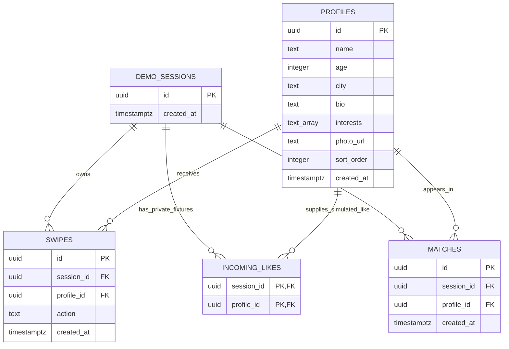

# Database guide

[Overview](../README.md) · [API architecture](API_ARCHITECTURE.md) · [Matching logic](MATCHING_LOGIC.md) · [Walkthrough](../PROJECT_WALKTHROUGH.md)

Neon hosts the application's PostgreSQL database. It stores the 36 fictional profiles, anonymous demo sessions, outgoing swipes, private incoming-like fixtures, and confirmed matches. React state is temporary; these records make progress survive a browser refresh and an application deployment.

PostgreSQL supplies transactions, row locks, foreign keys, and unique indexes. Drizzle expresses those queries and table definitions in TypeScript; `pg` provides the connection pool. See [schema.ts](../src/lib/db/schema.ts), [client.ts](../src/lib/db/client.ts), and the [initial SQL migration](../src/lib/db/migrations/0001_initial.sql).

## Relationships

Each interaction belongs to exactly one session and one profile. A session or profile can have zero or many interactions. There is no direct foreign key from `matches` to `swipes` or `incoming_likes`: the service verifies the two sides, and the Matches query joins both sides again before returning a record.

## Tables and columns

All listed columns are non-null. Drizzle uses camelCase property names for snake_case SQL columns, such as `sessionId` for `session_id`.

### `profiles`

| Column | Meaning and constraints |
| --- | --- |
| `id` | UUID primary key, supplied by the fixture file so seed IDs stay stable |
| `name`, `city`, `bio` | Fictional display information |
| `age` | Integer; database check requires `age >= 18` |
| `interests` | PostgreSQL `text[]` containing interest labels |
| `photo_url` | Local portrait path under `/demo-profiles/` |
| `sort_order` | Integer defining the repeatable feed order; not returned publicly |
| `created_at` | Timestamp with time zone, defaults to `now()` |

[profiles.ts](../src/data/profiles.ts) defines the 36 records. [seed.ts](../scripts/seed.ts) upserts those IDs, updating fixture fields without clearing interaction records. Incoming likes are **not** stored as a public profile flag.

### `demo_sessions`

| Column | Meaning and constraints |
| --- | --- |
| `id` | UUID primary key, generated by PostgreSQL with `gen_random_uuid()` |
| `created_at` | Timestamp with time zone, defaults to `now()` |

The `sessions` export in Drizzle maps to this SQL table. [getSession()](../src/lib/session/session.ts) looks up the UUID from the `coy_session` cookie. Missing, malformed, or unknown cookie values cause a new server-owned session to be created. Request bodies cannot choose the session.

### `swipes`

| Column | Meaning and constraints |
| --- | --- |
| `id` | Generated UUID primary key |
| `session_id` | Foreign key to `demo_sessions.id`; `ON DELETE CASCADE` |
| `profile_id` | Foreign key to `profiles.id`; no cascading profile deletion |
| `action` | `like` or `pass`, enforced by a database check as well as request validation |
| `created_at` | Timestamp with time zone, defaults to `now()` |

`unique_swipe(session_id, profile_id)` allows one outgoing decision per profile in a session. It prevents duplicate writes independently of frontend controls. Both actions remove the profile from that session's feed.

### `incoming_likes`

| Column | Meaning and constraints |
| --- | --- |
| `session_id` | Foreign key to `demo_sessions.id`; `ON DELETE CASCADE` |
| `profile_id` | Foreign key to `profiles.id`; no cascading profile deletion |

The pair `(session_id, profile_id)` is the composite primary key. An **outgoing like** is the visitor's decision in `swipes`. An **incoming like** is a private fixture simulating a profile having already liked that visitor. Neither a pass nor an outgoing like creates an incoming-like row.

`createSession()` creates the session and incoming fixtures in one transaction. It selects roster positions `0, 2, 6, 10, 14, 18, 23, 28, 33` in `sort_order` order. Aarohi and Meera therefore have incoming likes; Kabir does not. Those fixtures make the demonstration repeatable, and are never included in `/feed` responses or the frontend seed bundle.

### `matches`

| Column | Meaning and constraints |
| --- | --- |
| `id` | Generated UUID primary key |
| `session_id` | Foreign key to `demo_sessions.id`; `ON DELETE CASCADE` |
| `profile_id` | Foreign key to `profiles.id`; no cascading profile deletion |
| `created_at` | Timestamp with time zone, defaults to `now()`; serialized as `matchedAt` in the API |

`unique_match(session_id, profile_id)` prevents duplicate matches. `session_matches(session_id, created_at)` supports session-scoped match queries. A match is written in the same transaction as a new outgoing like, after verifying the private incoming like for the **same pair**.

The schema enforces references, allowed actions, adults, and uniqueness. Mutual interest is a service rule, not a cross-table database check. `listMatches()` independently rechecks an outgoing `like` and an incoming like, so an inconsistent row inserted outside the service is not exposed.

## Reset and persistence

[resetSession()](../src/lib/matching/service.ts) locks the current session row, deletes that session's `matches`, then deletes its `swipes`, and commits. It retains all profiles, the session, its private incoming likes, and every other session's records. The cookie remains valid, so the same visitor can replay the demonstration.

Refresh does not invoke reset. The cookie identifies the same session, `/feed` excludes saved decisions, and `/matches` restores verified matches. Cookies expire after one year; clearing cookies or using another browser creates another session. There is no localStorage fallback or cross-browser account recovery.

Deleting a session row directly would cascade to its swipes, incoming likes, and matches. The reset endpoint does **not** delete a session row. Profiles are retained and protected by their foreign-key references.

## Migrations and test databases

[migrate.ts](../scripts/migrate.ts) applies `0001_initial.sql` in a transaction, records it in `coy_migrations`, and uses an advisory lock to avoid concurrent migration runs. `coy_migrations` is a bookkeeping table, separate from the five application tables above. Existing databases need **no new migration** for the readability cleanup; table structure and predicates are unchanged.

Run migration and seeding explicitly against the intended database; builds never run them. Use a separate local PostgreSQL or Neon test database for tests, because tests create sessions, exercise reset, and delete their own fixtures. Never point test commands at the deployed application's database. See [local setup and testing](../README.md#local-installation).
