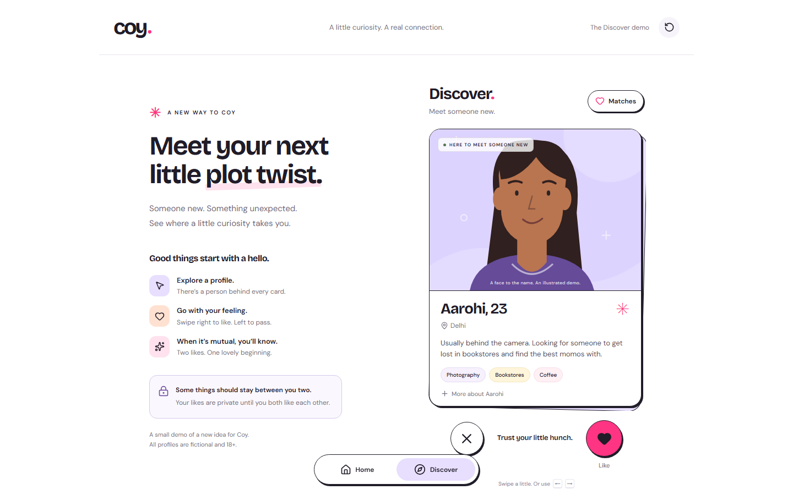
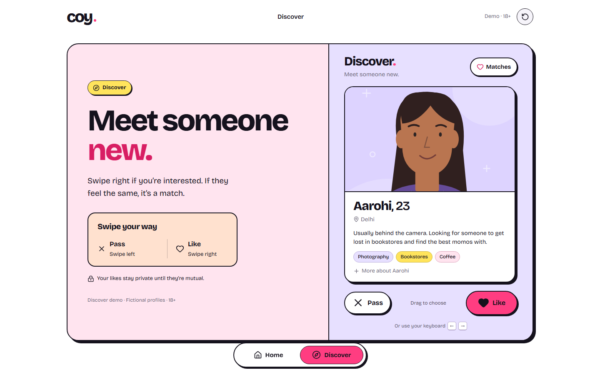
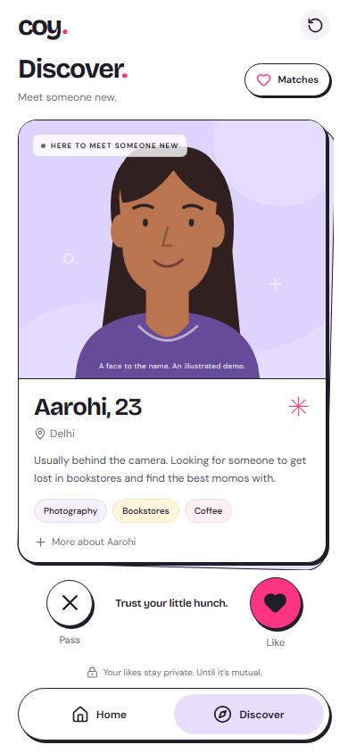
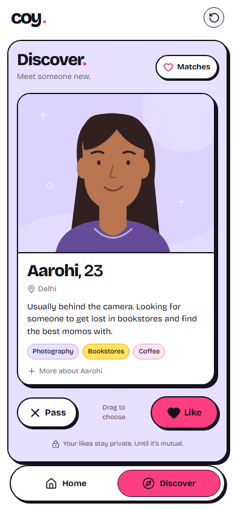

# Coy Discover: brand refinement

The redesign adapts the design system observed on [Coy's official website](https://getcoy.com/), rather than copying its marketing homepage. The original production app was captured before any source changes.

The before/after images below document the earlier redesign. The final publication replaces its typographic header approximation with Coy's official SVG; see the current [README screenshots](../../README.md#screenshots) and [asset sources](../../public/brand/README.md).

## What changed

- Replaced the three-row instructional section with one compact peach swipe guide and a single privacy line.
- Replaced the poetic headline and supporting copy with “Meet someone new.” and a functional explanation of mutual matching.
- Connected the desktop composition with a soft-pink introduction and lavender profile stage, enclosed by one dark outline and hard shadow.
- Switched to Bricolage Grotesque throughout, matching the official site. Increased heading, biography, and control legibility.
- Removed explanatory overlays and the extra sparkle from the profile card, preserving every existing illustration.
- Made Pass and Like labelled pill buttons, with pink active navigation, tactile pressed states, and consistent focus indicators.
- Applied the same pastel surfaces, borders, and shadows to Matches, profile details, celebration, Home, loading, and empty states.
- Hid the desktop introduction below 950px so tablet and mobile display the actual profile experience immediately.

## Measured brand values

Computed browser styles from getcoy.com on 19 November 2026:

| Token | Official value used |
| --- | --- |
| Typeface | Bricolage Grotesque; bold headings use 800 |
| Ink | `#15121D` |
| Pink | `#FF3D81` |
| Deep pink | `#D81E63` |
| Lavender | `#E7E0FF` |
| Soft pink | `#FFE4EF` |
| Peach | `#FFE1CF` |
| Yellow | `#FFE45C` |
| Mint | `#CBF4E0` |
| Outlines and shadows | 2px dark outlines; 3–6px hard offsets |

## Actual before and after screenshots

Each image uses the exact listed viewport, without cropping or image generation. After screenshots were captured from the production build connected to Neon. CSS entrance animations were fast-forwarded during capture so dialogs are shown at their final opacity.

| Viewport | Before | After |
| --- | --- | --- |
| Desktop, 1440 × 900 | [Open before](before-desktop.png) | [Open after](after-desktop.png) |
| Tablet, 768 × 1024 | [Open before](before-tablet.png) | [Open after](after-tablet.png) |
| Mobile, 390 × 844 | [Open before](before-mobile.png) | [Open after](after-mobile.png) |

| Before · desktop | After · desktop |
| --- | --- |
|  |  |

| Before · mobile | After · mobile |
| --- | --- |
|  |  |

Additional inspected screens:

- [Matches](after-matches-desktop.png), [mobile Matches](after-matches-mobile.png), [profile details](after-details-mobile.png).
- [Celebration](after-celebration-desktop.png), [mobile celebration](after-celebration-mobile.png).
- [Empty Discover](after-empty-mobile.png), [empty Matches](after-empty-matches-mobile.png), [loading](after-loading-mobile.png), [Home placeholder](after-home-mobile.png).

Empty-state and loading screenshots use browser-level response/timing controls solely for visual capture. The existing browser tests separately exercise a real exhausted feed, reset, and empty matches against PostgreSQL.

## Modified presentation files

`src/app/globals.css`, `src/app/layout.tsx`, and the existing Shell, Intro, Discover, ProfileCard, MatchCelebration, and MatchesView components. No new dependency was introduced. API routes, database schema, seed data, portraits, matching rules, sessions, and existing test files are unchanged.

## Visual checks

Desktop, tablet, and mobile screenshots were opened and inspected. Browser measurements confirmed no horizontal overflow and both action buttons above the fixed navigation at each requested viewport. The rendered body font is Bricolage Grotesque, and no browser console or page errors occurred in these walkthroughs. Matches, celebration, profile details, loading, empty states, and Home were also visually inspected.

The responsive card widths are 411px on desktop, 475px on tablet, and 329px on mobile. The two-column layout is intentionally replaced by a single profile stage on tablet, rather than compressing both desktop columns.

## Verification results

| Check | Result |
| --- | --- |
| TypeScript and route type generation | Passed |
| ESLint | Passed, zero errors or warnings |
| Production build | Passed |
| Existing Vitest suite against Neon | 18/18 passed |
| Existing desktop and mobile Playwright suite | 12/12 passed against the production server, 2.2 minutes |
| Desktop buttons and mobile touch gestures | Passed |
| Match celebration, details, navigation, reload persistence | Passed |
| All 36 portrait URLs | Passed |
| Session isolation, reset, hidden-like privacy | Passed |
| Requested screenshot sizes | Captured and inspected at 1440 × 900, 768 × 1024, and 390 × 844 |
| API/schema/data/portrait/test source diff | No changes |

The existing tests were run without editing their assertions or removing any cases. The screenshot walkthrough also checked dialog focus and recorded zero console or page errors at all three requested sizes.
